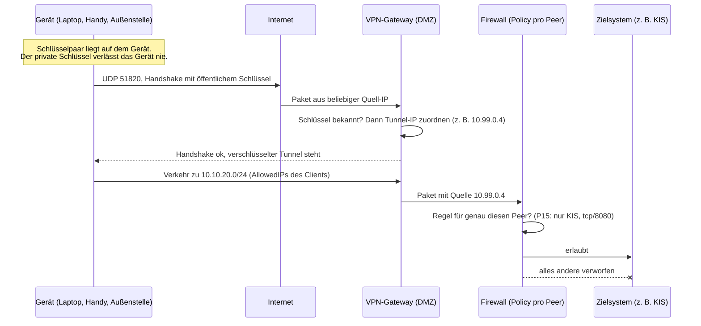
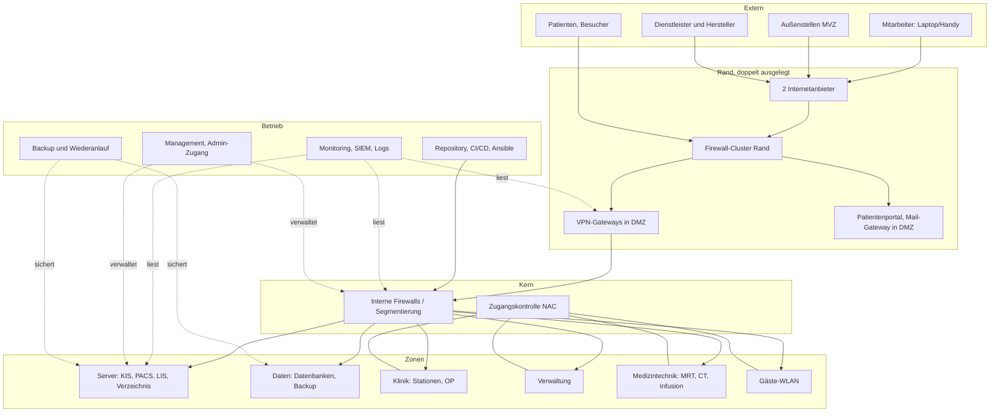

# VPN im Klinikum: Wie es in echt aussieht und betrieben wird

Dieses Dokument erklärt, was im Lab nachgebaut ist, wie es in einem echten Krankenhaus aussieht und wer wofür zuständig ist. Das Lab zeigt das **Prinzip**. Ein echtes Klinikum hat mehr Standorte, doppelte Geräte, ein Identitätssystem mit Mehrfaktor-Anmeldung und Vorgaben aus Gesetzen und Normen.

## 1. Was passiert, wenn sich jemand per VPN verbindet

Wichtige Punkte:

- **WireGuard kennt nur Schlüssel**, keine Benutzer. Ein Peer ist „wer den privaten Schlüssel hat“. Deshalb gehört im Betrieb eine Identitätsschicht davor (siehe Abschnitt 3).
- **Zwei Ebenen für Rechte:** `AllowedIPs` am Client (was wird in den Tunnel geroutet) und die Firewall-Regel pro Tunnel-IP (was darf durch). Die Firewall ist maßgeblich.
- **Roaming:** Wechselt das Handy von WLAN auf Mobilfunk, ändert sich die Quell-IP, der Tunnel bleibt bestehen. Der Standort der Quell-IP springt dann.
- **Keepalive** (im Lab 15 s) hält den Tunnel hinter NAT offen und liefert die „letzter Handshake“-Zeit fürs Monitoring.

## 2. Wer verbindet sich womit?

| Gerätetyp | Beispiel im Lab | Im echten Betrieb | Rechte |
|---|---|---|---|
| Admin-Laptop | `admin-laptop` | verwaltetes Notebook (MDM/Domäne), Anmeldung mit MFA | Management, kein KIS |
| Dienst-Handy | `aerztin-handy` | verwaltetes Smartphone (MDM), VPN-App oder Always-On | nur KIS-Weboberfläche |
| Standortkopplung | `mvz-aussenstelle` | Router oder Firewall der Außenstelle (Site-to-Site) | festgelegte Dienste, kein Mensch dahinter |
| Dienstleister/Hersteller | nicht im Lab | zeitlich befristeter Zugang, Sitzung wird protokolliert | nur das eine Gerät, nur im Wartungsfenster |
| Medizingerät (Fernwartung) | nicht im Lab | meist Hersteller-Zugang über getrennten Zugang | strikt nur das eigene Gerät |

Privatgeräte (BYOD) bekommen im Klinikumsumfeld meist keinen Zugang zum KIS. Wenn doch, dann nur über einen Remote-Desktop/Gateway, nicht über ein Netzwerk-VPN.

## 3. Was in Produktion zusätzlich da sein muss

| Baustein | Zweck | Beispiele |
|---|---|---|
| Identität und MFA | „Wer ist es?“ statt „wer hat den Schlüssel?“ | Entra ID, Keycloak, AD mit MFA |
| Gerätezustand | nur verwaltete, gepatchte Geräte | MDM (Intune), Zertifikat auf dem Gerät, NAC |
| VPN-Produkt mit Benutzerverwaltung | Konten, Gruppen, Sitzungslisten, Protokolle | Firezone, Netbird, Tailscale/Headscale, oder Firewall-Hersteller-VPN (Fortinet, Palo Alto, Cisco) |
| Protokollierung | Nachvollziehbarkeit | Syslog an SIEM, Aufbewahrung nach Vorgabe |
| Hochverfügbarkeit | Ausfall von Gateway oder Leitung | zwei Gateways, zwei Provider, Firewall-Cluster |
| Zertifikate/PKI | Gerätezertifikate, Web-Zertifikate | interne CA, Ablauf-Monitoring |

Pures WireGuard wird in Kliniken eher als Baustein (z. B. unter Netbird/Firezone) eingesetzt als nackt. Das Prinzip bleibt gleich.

## 4. Was man im Live-System sieht

| Frage | Wo im Lab | Wo im echten Betrieb |
|---|---|---|
| Wer ist gerade verbunden? | Portal → VPN, Grafana „Klinikum-VPN Live“ | Admin-Oberfläche des VPN-Produkts, `wg show`, Firewall-Sitzungstabelle |
| Von wo? | Karte mit simulierten Standorten | GeoIP der Quell-IP (grob), Gerätestandort nur bei MDM mit Zustimmung |
| Wie viel Verkehr? | Tabelle und Grafana (`wireguard_*_bytes_total`) | Exporter, Flow-Daten, Firewall-Statistik |
| Seit wann getrennt? | „Letzter Handshake“, Alarm `VpnPeerOhneHandshake` | Monitoring mit Alarm und Rufbereitschaft |
| Auffällig? | Alarm `VpnPeerUnerwartetesLand` (Demo: Reise simulieren) | SIEM-Regeln: unmögliche Reise, neues Land, Anmeldung außerhalb der Zeit |
| Was durfte er? | Firewall-Zähler pro Regel, Matrix | Firewall-Protokolle pro Regel und Nutzer |

**Genauigkeit:** GeoIP trifft Stadt- bis Regionsebene, bei Mobilfunk, Firmen-Proxys und Satelliten-Internet oft falsch. Es ist ein Hinweis, kein Beweis. Das Lab nutzt deshalb simulierte Standorte.

**Datenschutz:** Standortdaten von Beschäftigten sind personenbezogen. In Deutschland gelten DSGVO und Mitbestimmung (Betriebs- oder Personalrat). Üblich: nur Land und Zeitpunkt, kurze Speicherdauer, Zweck „Sicherheit“, Regelung per Dienstvereinbarung. Das Lab speichert nichts dauerhaft. Der Exporter läuft ohne `-r` (keine Quell-IP als Label).

## 5. Rollen: Infrastruktur und Betrieb gegen Anwendung

| Aufgabe | Infrastruktur / Betrieb | Anwendung (KIS, PACS, LIS) | Fachabteilung / Datenschutz |
|---|---|---|---|
| Zonen, Firewall, VPN-Gateway | **verantwortlich** | informiert | informiert |
| Neue VPN-Berechtigung umsetzen | **führt aus** (Pull Request, Deployment) | prüft Bedarf | genehmigt |
| Benutzerkonten und Rechte im KIS | Konten im Verzeichnisdienst | **verantwortlich** (Rollen im Programm) | legt Berechtigungen fest |
| Client-Software und MDM | **verantwortlich** | informiert | informiert |
| Monitoring, Alarme, Rufbereitschaft | **verantwortlich** | liefert Anwendungs-Checks | informiert |
| Patches Server/Gateway | **verantwortlich** | Freigabe der Hersteller | Wartungsfenster abstimmen |
| Medizingeräte | Netz und Segment | Schnittstelle (DICOM, HL7) | **Medizintechnik** verantwortlich |
| Protokolle, Löschfristen | technisch umsetzen | liefert Anwendungsprotokolle | **Datenschutz** legt fest |

Als Netzwerkspezialist im Betrieb bist du für die linke Spalte zuständig. Du musst aber die Anwendungsseite verstehen: Welche Ports braucht das KIS? Was geschieht, wenn eine Schnittstelle ausfällt?

## 6. Workflow: neuen VPN-Zugang einrichten (wie im Lab)

```mermaid
flowchart LR
    A[Antrag mit Begründung] --> B[Genehmigung Fachbereich + Sicherheit]
    B --> C[Gerät registrieren, Schlüsselpaar auf dem Gerät erzeugen]
    C --> D[Öffentlichen Schlüssel und Rechte in der YAML eintragen]
    D --> E[Pull Request]
    E --> F[CI: Policy-Check und Sicherheitsaussagen]
    F --> G[Review durch zweite Person]
    G --> H[Deployment per Ansible]
    H --> I[Abnahme: Matrix und Test vom Gerät]
    I --> J[Übergabe an Nutzer]
    J --> K[Regelmäßige Rezertifizierung, Entzug bei Austritt]
```

Im Lab entspricht das: Peer in `topology/klinikum.yml` eintragen → `make check` → `make render` → Rollout → Portal zeigt den Peer, die Matrix bestätigt die Rechte. Ein Zugang entsteht also nie per Klick auf dem Gateway, sondern nachvollziehbar per Änderung im Repository.

**Entzug:** Peer aus der YAML entfernen, Deployment, Schlüssel gilt nicht mehr. Bei verlorenem Gerät sofort, nicht erst beim nächsten Release (Notfallweg dokumentieren).

## 7. Rollout (stufenweise einführen)

1. **Pilot** mit 2 bis 3 Nutzern (Admin-Laptop, ein Handy), Monitoring beobachten.
2. **Schrittweise** nach Gruppe (Bereitschaft, Außenstellen, Dienstleister).
3. **Änderungsfenster** abstimmen, **Rückfallweg** festlegen (alte Einwahl bleibt bis zur Abnahme).
4. **Nach jedem Schritt** Matrix, Alarme, Nutzerfeedback prüfen.
5. Erst dann die alte Lösung abschalten.

## 8. Wie komplex ist ein echtes Klinikum-Netz?

Was es zusätzlich zum Lab in echt gibt: mehrere Standorte mit Standortkopplung, redundante Geräte und Leitungen, tausende Endgeräte, Hersteller-Fernwartung, Verzeichnisdienst mit Gruppenrichtlinien, PKI, NAC, SIEM, Backup mit Wiederanlauftests, Notfallbetrieb (was geschieht, wenn das KIS steht) und Nachweispflichten.

Rahmen (zur Orientierung, keine Rechtsberatung): Datenschutz-Grundverordnung, branchenspezifischer Sicherheitsstandard für Krankenhäuser (B3S) bei KRITIS-Häusern, gesetzliche Pflicht zu angemessener IT-Sicherheit in Krankenhäusern (§ 75c SGB V), ISO 27001 als gängiges Managementsystem. Prüfe die aktuelle Fassung vor jeder Aussage im Gespräch.

## 9. Fehlersuche: „Peer verbindet nicht“

1. Handshake da? `wg show wg0` auf dem Gateway: Spalte „latest handshake“. Nie = Paket kommt nicht an oder Schlüssel falsch.
2. UDP 51820 erreichbar? Firewall/Provider-Router prüfen (Regel P11), NAT-Weiterleitung.
3. Öffentlicher Schlüssel und `AllowedIPs` des Peers am Gateway stimmen? (Tippfehler im Schlüssel ist häufig.)
4. Uhrzeit: stark falsche Uhr stört den Handshake.
5. Tunnel steht, aber Dienst nicht erreichbar? Das ist die Firewall: Zähler der Peer-Regel und `default-deny` im Portal ansehen. Stimmt die Rückroute zum Tunnelnetz?
6. MTU-Probleme (große Pakete hängen, kleine gehen): MTU am Client auf 1380 testen.
7. Nur bei einem Gerät: Client-Konfiguration, `AllowedIPs` zu eng, DNS.

## 10. Lab gegen Wirklichkeit

| Lab | Wirklichkeit |
|---|---|
| Docker-Netze als Zonen | VLANs auf Switches, getrennte Firewall-Schnittstellen |
| nftables-Container | Firewall-Cluster eines Herstellers, gleiche Logik (Zonen, Regeln, Zähler) |
| WireGuard-Container | VPN-Gateways mit Benutzerverwaltung und MFA |
| Simulierte Standorte | GeoIP, ungenau, datenschutzrechtlich zu regeln |
| YAML + Generator + CI | gleiches Prinzip (Policy as Code), nur größer und mit Genehmigungen |
| Portal-Matrix | Abnahmetests und Audit-Berichte |
